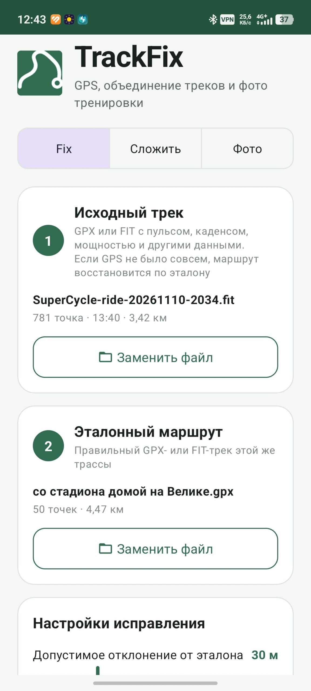
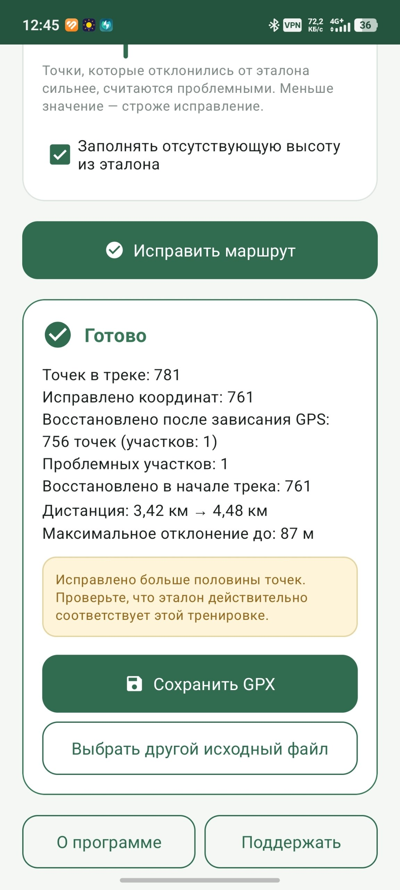
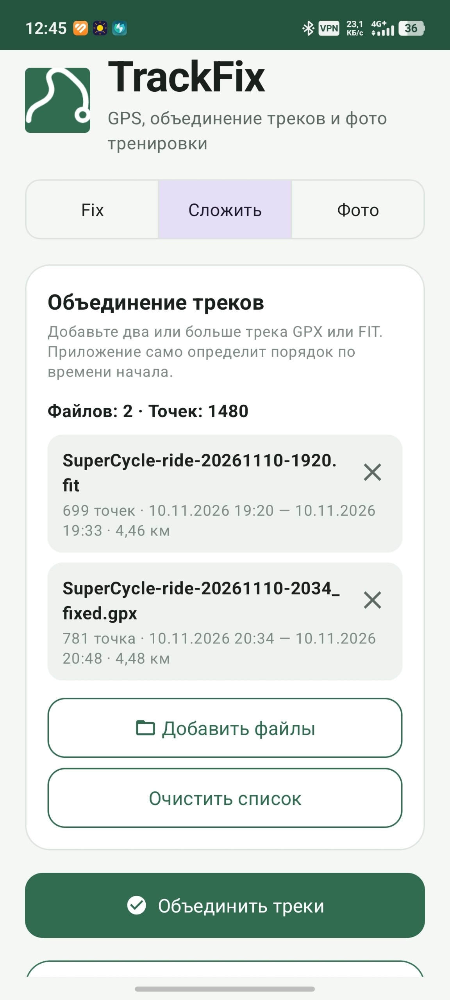
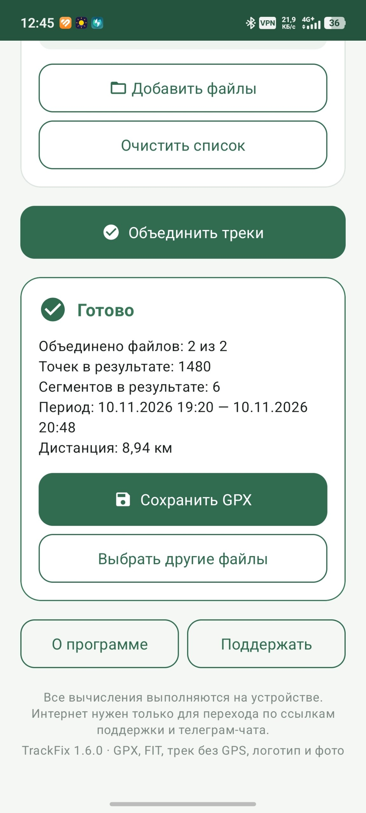
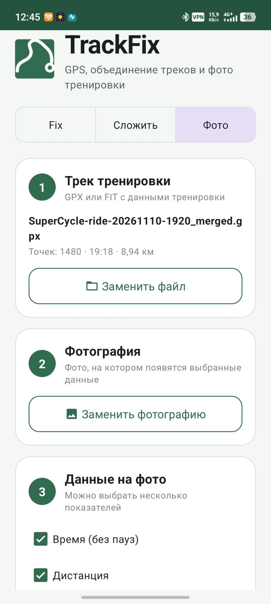
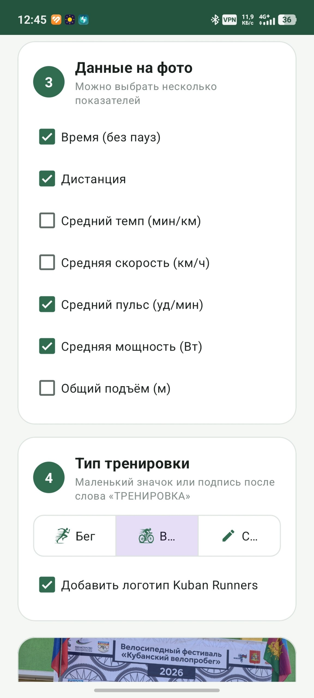
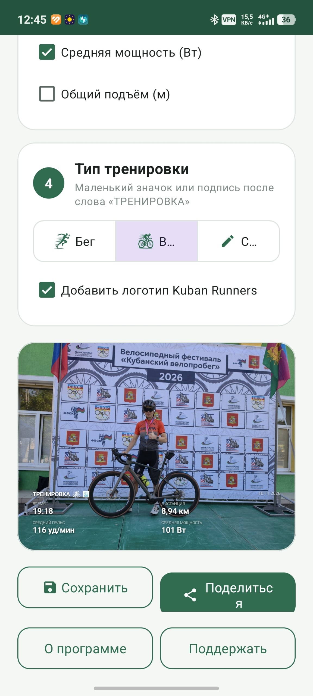
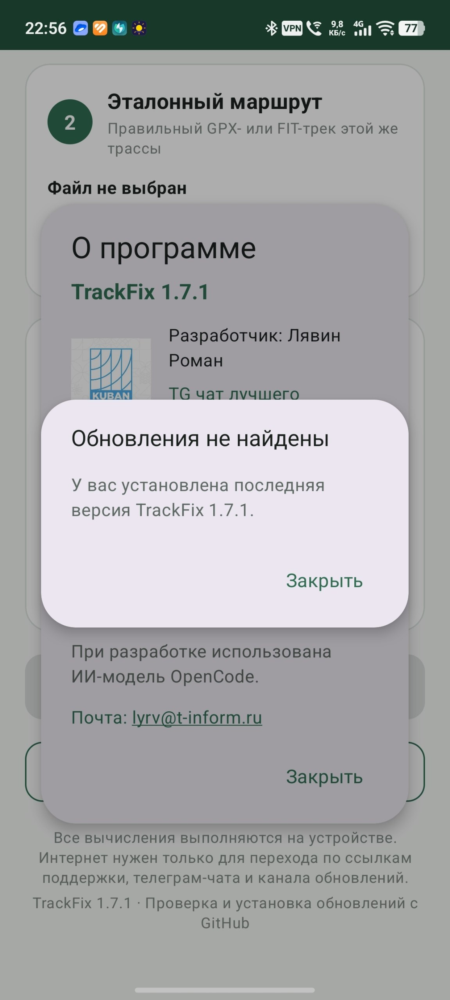

# TrackFix

Android-приложение для исправления GPS-координат в треке GPX или FIT по эталонному маршруту, для объединения нескольких треков в один GPX и для наложения статистики тренировки на фотографию.

В обычном режиме исправления приложение не добавляет и не удаляет точки, не меняет время и данные датчиков. Оно исправляет только координаты проблемных точек, включая пропуски GPS в начале и конце трека, и, по желанию, заполняет отсутствующую высоту. Если в исходной записи вообще не было GPS-координат, но есть пульс, темп или каденс, маршрут автоматически восстанавливается по эталону: дистанция эталона распределяется пропорционально расстоянию, которое прошёл исходный трек по накопленной дистанции или скорости, а длинные пропуски записей заполняются промежуточными точками вдоль эталона, чтобы трек не срезал круг. В режиме объединения несколько треков GPX или FIT собираются в один GPX в хронологическом порядке. В режиме «Фото» выбранные показатели тренировки рисуются поверх фотографии, а после слова «ТРЕНИРОВКА» можно добавить значок бега, велосипеда, свой текст и логотип Kuban Runners. Готовую картинку можно сохранить или отправить в другое приложение. Результат исправления и объединения всегда сохраняется в GPX.

## Что нового в 1.7.9

- В обычном режиме исправления стабильные GPS-координаты больше не заменяются эталоном: длинный участок, пройденный по другой, но корректной дороге, сохраняется как есть. По эталону чинится только потерянный хвост с 28:45 до конца записи.
- Полная подстановка координат эталоном по-прежнему работает только при включённой галочке «Полностью брать трек из эталона».
- В режиме «Сложить» сохраняется тип тренировки из первого по времени файла: объединённый GPX больше не теряет `<type>` и не определяется как бег вместо велопоездки.

## Что нового в 1.7.8

- Полностью брать трек из эталона — В обычном режиме исправления приложение не добавляет и не удаляет точки, не меняет время и данные датчиков.
- полностью gramatikal errors

## Что нового в 1.7.7

- Исправлены скачки GPS на эталонных маршрутах с повторяющимися кругами
- Положите таке трек из эталона — В обычном режиме исправления приложение не добавляет и не удаляет точки, не меняет время и данные датчиков.
- **Подпись не меняется у новых версий** — используйте тот же keystore для всех обновлений.

## Что нового в 1.7.6

- Маршрут восстановлен по эталону — В обычном режиме исправления приложение не добавляет и не удаляет точки, не меняет время и данные датчиков.
- Теперь версия во всех окнах приложения совпадает с версией APK.
- **Подпись не меняется у новых версий** — используйте тот же keystore для всех обновлений.

## Что нового в 1.7.4

- Исправлены неточности в окне «О программе»: страница показывала старую версию 1.7.2 вместо актуальной. Теперь версия во всех окнах приложения совпадает с версией APK.

## Что нового в 1.7.3

- Исправлены скачки GPS на эталонных маршрутах с повторяющимися кругами и самопересечениями: ремонт больше не перескакивает на соседнюю ветку или другой круг стадиона.
- На треке 10 ноября трек плавно продолжается от последней реальной GPS-точки и завершает 16 полных кругов на стартовой линии.
- На треке 12 ноября устранён скачок 331 м на 17:27 и восстановлен участок 17:45–17:46.
- Пропуски GPS в начале и конце трека привязываются к стартовой линии эталона: трек начинается и заканчивается в одной точке.
- Добавлена защита от неправдоподобных скачков накопленной дистанции и скорости в исходной записи.

## Что нового в 1.7.2

- Репозиторий и релизы TrackFix перенесены на аккаунт `RomanLyavin`: приложение проверяет и скачивает обновления с `https://github.com/RomanLyavin/TrackFix`.
- Встроенный GitHub-токен убран: репозиторий публичный, приложение обращается к GitHub анонимно.
- В «О программе» строка «Обновить» теперь называется «TG программы», а «Проверить обновления» — «Обновления».
- При нажатии «Обновления» приложение сначала спрашивает: проверить новую версию или открыть страницу программы на GitHub.

## Что нового в 1.7.0

- Ремонт трека теперь опирается на движение из исходной записи, а не на одну среднюю скорость. Для каждого интервала берётся приращение накопленной дистанции `<distance>`, затем скорость × время, затем равномерное время. Дистанция эталона распределяется между точками в той же пропорции, поэтому быстрые интервалы получают больше пути, а медленные и паузы — меньше. Это работает и для трека без GPS, и для «зависших» GPS-координат.
- На реальной записи с длинными пропусками ошибка темпа снизилась с 5,97% до 0,13%; на SuperCycle GPX и FIT она остаётся ниже 0,1%.
- В режиме «Фото» показатели и логотип Kuban Runners увеличены примерно в 1,5 раза. Подписи остались обычными, значения — жирными.
- В «О программе» вместо видимой ссылки появился текст «TG чат лучшего бегового [иконка бегуна] клуба KR»: иконка бегуна окрашена в цвет бренда, по нажатию открывается чат. Добавлен раздел «Обновить» со ссылкой на канал свежих версий `https://t.me/trackFix`.
- Основные вкладки по-прежнему называются `Fix`, `Сложить`, `Фото`.

История изменений по версиям: [CHANGELOG.md](CHANGELOG.md). Подробное описание алгоритмов: [docs/HOW_IT_WORKS.md](docs/HOW_IT_WORKS.md).

## Установка

Готовые подписанные APK опубликованы на странице
[Releases](https://github.com/RomanLyavin/TrackFix/releases). Для установки
скачайте последнюю версию `TrackFix-1.7.9.apk`.

Пакет: `com.trackfix.app`, минимальная версия Android — 8.0 (API 26).

Установка на подключённый телефон:

```powershell
adb install -r TrackFix-1.7.9.apk
```

Либо скопируйте APK на телефон и откройте его, разрешив установку из неизвестных источников.

## Все версии

Полная история изменений — в [CHANGELOG.md](CHANGELOG.md). В каждом релизе есть подписанный APK и подробное описание:

| Версия | Изменения | APK |
| --- | --- | --- |
| 1.7.9 | Стабильный GPS сохраняется, исправляется только потерянный хвост; тип тренировки сохраняется при объединении | [APK](https://github.com/RomanLyavin/TrackFix/releases/download/v1.7.9/TrackFix-1.7.9.apk) |
| 1.0 | Первая версия: исправление GPS-координат GPX по эталону | [APK](https://github.com/RomanLyavin/TrackFix/releases/download/v1.0/TrackFix-1.0.apk) |
| 1.1 | Поддержка FIT на входе | [APK](https://github.com/RomanLyavin/TrackFix/releases/download/v1.1/TrackFix-1.1.apk) |
| 1.2 | Режим «Сложить»: объединение треков GPX и FIT | [APK](https://github.com/RomanLyavin/TrackFix/releases/download/v1.2/TrackFix-1.2.apk) |
| 1.2.1 | Исправления объединения и сводки | [APK](https://github.com/RomanLyavin/TrackFix/releases/download/v1.2.1/TrackFix-1.2.1.apk) |
| 1.3.0 | Режим «Фото»: статистика тренировки на фотографии | [APK](https://github.com/RomanLyavin/TrackFix/releases/download/v1.3.0/TrackFix-1.3.0.apk) |
| 1.3.1 | Исправлено чтение фотографии из галереи | [APK](https://github.com/RomanLyavin/TrackFix/releases/download/v1.3.1/TrackFix-1.3.1.apk) |
| 1.4.0 | Тип тренировки: бег, вело или свой текст | [APK](https://github.com/RomanLyavin/TrackFix/releases/download/v1.4.0/TrackFix-1.4.0.apk) |
| 1.5.0 | Восстановление трека без GPS по эталону | [APK](https://github.com/RomanLyavin/TrackFix/releases/download/v1.5.0/TrackFix-1.5.0.apk) |
| 1.6.0 | Промежуточные точки в длинных пропусках, логотип Kuban Runners | [APK](https://github.com/RomanLyavin/TrackFix/releases/download/v1.6.0/TrackFix-1.6.0.apk) |
| 1.7.0 | Распределение дистанции по движению, крупные показатели на фото | [APK](https://github.com/RomanLyavin/TrackFix/releases/download/v1.7.0/TrackFix-1.7.0.apk) |
| 1.7.1 | Проверка и установка обновлений из приложения | [APK](https://github.com/RomanLyavin/TrackFix/releases/download/v1.7.1/TrackFix-1.7.1.apk) |
| 1.7.2 | Перенос обновлений на RomanLyavin, новые названия строк и выбор GitHub | [APK](https://github.com/RomanLyavin/TrackFix/releases/download/v1.7.2/TrackFix-1.7.2.apk) |
| 1.7.3 | Плавный ремонт треков с повторяющимися кругами и самопересечениями | [APK](https://github.com/RomanLyavin/TrackFix/releases/download/v1.7.3/TrackFix-1.7.3.apk) |
| 1.7.8 | полностью gramatikal errors | [APK](https://github.com/RomanLyavin/TrackFix/releases/download/v1.7.8/TrackFix-1.7.8.apk) |
| 1.7.7 | Маршрут восстановлен по эталону | [APK](https://github.com/RomanLyavin/TrackFix/releases/download/v1.7.7/TrackFix-1.7.7.apk) |
| 1.7.6 | Маршрут восстановлен по эталону | [APK](https://github.com/RomanLyavin/TrackFix/releases/download/v1.7.6/TrackFix-1.7.6.apk) |
| 1.7.4 | Исправлены неточности в окне «О программе» | [APK](https://github.com/RomanLyavin/TrackFix/releases/download/v1.7.4/TrackFix-1.7.4.apk) |
| 1.7.5 | Маршрут восстановлен по эталону — В обычном режиме исправления приложение не добавляет и не удаляет точки, не меняет время и данные датчиков. | [APK](https://github.com/RomanLyavin/TrackFix/releases/download/v1.7.5/TrackFix-1.7.5.apk) |

## Как пользоваться

### Режим «Исправление»

1. Выберите исходный трек — GPX или FIT с пульсом, каденсом, мощностью и другими данными, у которого нужно исправить координаты.
2. Выберите эталонный трек — корректный GPX или FIT этой же трассы. Эталон может содержать несколько кругов и сегментов авто-паузы.
3. Если в исходном файле нет ни одной GPS-координаты, приложение автоматически восстановит маршрут по самому длинному пути эталона. Для этого в треке должно быть время движения: паузы определяются по нулевой скорости, а если её нет — по каденсу.
4. Настройте допустимое отклонение:
   - по умолчанию 30 м;
   - меньше значение — строже исправление, больше — приложение вмешивается меньше.
5. При необходимости оставьте включённым заполнение отсутствующей высоты из эталона.
6. Нажмите «Исправить маршрут».
7. Проверьте сводку и нажмите «Сохранить GPX». Файл сохраняется через системный диалог с суффиксом `_fixed`.

| Выбор треков | Результат |
| --- | --- |
|  |  |

### Режим «Объединение»

1. Переключитесь на вкладку «Объединение».
2. Добавьте два или больше трека GPX или FIT. Список можно дополнять, а лишние файлы — удалять.
3. Нажмите «Объединить треки».
4. Приложение само сортирует файлы по времени начала. Точки следующего файла, время которых уже есть в объединённой части, обрезаются, чтобы не было возврата назад по времени.
5. Проверьте сводку и сохраните один GPX с суффиксом `_merged`.

Если в файле нет ни одной отметки времени, объединение невозможно: приложение покажет имя такого файла и попросит удалить его из списка.

| Список треков | Результат |
| --- | --- |
|  |  |

### Режим «Фото»

1. Переключитесь на вкладку «Фото».
2. Выберите трек тренировки — GPX или FIT. Приложение посчитает время без пауз, дистанцию, средний темп, среднюю скорость, средний пульс, среднюю мощность и общий подъём.
3. Выберите фотографию. Ориентация из EXIF учитывается, а размер уменьшается до безопасного для памяти.
4. Отметьте нужные показатели. Недоступные пункты (например, пульс в треке без пульсометра) неактивны; по умолчанию выбраны время и дистанция.
5. В карточке «Тип тренировки» выберите «Бег», «Вело» или «Своё». Для своего варианта введите текст до 24 символов — он появится после слова «ТРЕНИРОВКА». Выбор запоминается. Там же галочкой «Добавить логотип Kuban Runners» включается логотип после значка тренировки; по умолчанию он включён.
6. Посмотрите предпросмотр. На фотографии остаются только текст «ТРЕНИРОВКА», значок или название тренировки, логотип (если включён) и выбранные показатели. Панели, рамки и затемнения нет — текст держится на мягкой тени, пропорции снимка сохраняются.
7. Нажмите «Сохранить», чтобы записать PNG через системный диалог, или «Поделиться», чтобы отправить картинку в другое приложение.

Время без пауз считается по интервалам не длиннее 30 секунд, в которых трек действительно двигался; разрывы между сегментами и длительные остановки не учитываются. Средний темп и средняя скорость появляются только при достаточной дистанции, а общий подъём сглаживает мелкие колебания высоты.

| Трек и фото | Показатели | Готовое фото |
| --- | --- | --- |
|  |  |  |

### О программе и поддержка

Внизу экрана есть кнопки «О программе» и «Поддержать». В «О программе» указаны разработчик, логотип Kuban Runners и контактная почта. Строка «TG чат лучшего бегового [иконка бегуна] клуба KR» открывает чат `https://t.me/+0oJbL1UtVVhkYzli`, сам адрес на экране не показывается. Раздел «TG программы» открывает канал со свежими версиями `https://t.me/trackFix`. Раздел «Обновления» сначала предлагает проверить новую версию на GitHub или открыть страницу программы `https://github.com/RomanLyavin/TrackFix`: при проверке приложение запрашивает последний релиз, предлагает скачать APK и открывает системный установщик, а если версия не новее — сообщает, что установлена последняя. В «Поддержать» открывается картинка; нажмите на неё, чтобы перейти на страницу поддержки.

<p align="center">
  
</p>

## Что именно меняется

- Координаты (`lat`, `lon`) только проблемных точек.
- «Зависшие» координаты, когда GPS перестал обновлять позицию, но датчики показывают движение, распределяются вдоль эталона пропорционально расстоянию из исходной записи: накопленной дистанции, скорости или, если их нет, времени.
- Отсутствующие координаты заполняются по эталону.
- Если координат нет вообще, весь маршрут восстанавливается по эталону: дистанция распределяется пропорционально расстоянию из исходной записи (накопленная дистанция → скорость → время), а паузы удерживают позицию.
- В треке без GPS длинные пропуски записей заполняются промежуточными точками вдоль эталона примерно через каждые 10 м. Это единственный случай, когда в режиме исправления добавляются новые точки: без них между далёкими записями получалась прямая через круг.
- Пропуски GPS в начале и конце трека заполняются по эталону, если в этих местах уже есть точки с временем или данными датчиков.
- Отсутствующая высота (`ele`) заполняется из эталона, если включена соответствующая настройка.
- В восстановленном треке без GPS удаляется устаревшая накопленная дистанция `<distance>`: она относится к старой геометрии, а сервисы вроде Strava должны считать длину по новым координатам.
- В режиме объединения точки всех файлов переносятся в один GPX без изменения времени, высоты и данных датчиков; пересекающиеся по времени точки обрезаются.
- В режиме объединения каждый непустой сегмент исходных файлов сохраняется отдельным `<trkseg>`, поэтому между разными записями и паузами нет соединительных линий, а сервисы вроде Strava корректно считают общую дистанцию.
- В режиме объединения из точек удаляется накопленная дистанция `<distance>`: в каждом исходном файле она начинается с нуля, и если оставить старые значения, Strava и подобные сервисы показывают дистанцию только одного файла. Дистанция в сводке и в принимающих сервисах считается по координатам.

Не меняются:

- порядок исходных точек и их время;
- пульс, каденс, мощность, температура;
- существующая высота;
- расширения GPX и прочие данные (кроме устаревшей накопленной дистанции при объединении и восстановлении трека без GPS).

Количество исходных точек сохраняется. Исключение — длинные пропуски записей в треке без GPS: внутри них добавляются промежуточные точки, иначе маршрут срезал бы круг прямой линией. У таких новых точек есть только координаты, время и, при включённой настройке, высота из эталона; данные датчиков для них не выдумываются.

В обычном режиме исправления новые точки и сегменты не создаются. Начало и конец трека не продлеваются: заполняются только уже существующие точки, а если эталон не покрывает участок, точки остаются без изменений или помечаются как неисправленные. Плавные участки, которые уходят в сторону от эталона и затем возвращаются (реальный обход, другая полоса), не притягиваются к эталону без признаков GPS-сбоя. Режим «Фото» не изменяет трек: он только читает его и рисует картинку.

## Как работает алгоритм

1. GPX разбирается как XML DOM, поэтому все расширения сохраняются. FIT разбирается встроенным парсером и преобразуется в GPX в памяти: координаты, время, высота, дистанция, скорость, пульс, каденс, мощность и температура.
2. Эталон превращается в набор полилиний; для быстрого поиска используется пространственная сетка. Сегменты эталона, разделённые авто-паузой, склеиваются, если разрыв между ними не больше 100 м.
3. Для каждой точки исходного трека находится ближайшая проекция на эталон.
4. Проблемными считаются:
   - точки без координат;
   - точки, улетевшие далеко от эталона;
   - участки с аномальными скачками скорости, если они одновременно далеко от эталона;
   - «зависшие» участки: подряд идущие точки с одинаковыми координатами, хотя накопленная дистанция или скорость показывают движение.
5. Для проблемного участка ищутся надёжные опорные точки до и после него. Координаты восстанавливаются вдоль эталона с учётом времени, накопленной дистанции и выбора правильного круга/направления. Для зависшего участка точки распределяются по эталону пропорционально расстоянию из исходника: сначала приращению `<distance>`, затем скорости × время, затем времени.
6. Пропуски координат в начале и конце трека восстанавливаются от ближайшей существующей GPS-точки в сторону эталона. Для таких участков допускается опорная точка, которая сама немного смещена от эталона; новые точки не создаются.
7. Участки на границе трека, которые просто выходят за пределы эталона, намеренно не притягиваются обратно.
8. Результат сериализуется обратно в GPX без изменения структуры и расширений.

### Трек без GPS

1. Если в исходном файле нет ни одной корректной координаты, обычное сопоставление с эталоном невозможно. Приложение берёт самый длинный путь эталона и проходит его от первой точки.
2. Паузой считается точка, у которой скорость не больше 0,05 м/с, либо, если скорости нет, каденс не больше нуля. Интервал остаётся подвижным, пока хотя бы один из его концов не является паузой.
3. Суммируется всё время движения и расстояния подвижных интервалов по данным исходника.
4. Для каждого подвижного интервала вычисляется расстояние по данным исходника: приращение накопленной дистанции, если оно монотонно и правдоподобно; иначе скорость × время; если скорости нет — медианная скорость или время. Дистанция эталона распределяется между интервалами пропорционально этим расстояниям.
5. На каждом подвижном интервале позиция сдвигается вдоль эталона на долю эталонной длины, соответствующую расстоянию интервала. На паузе позиция не меняется, поэтому остановки остаются на месте.
6. Исходные точки, их порядок, время, пульс, каденс и существующая высота сохраняются. Отсутствующая высота при включённой настройке берётся из эталона.
7. Если подвижный интервал длится не меньше 15 секунд и сдвигает позицию не меньше чем на 30 м, внутри него добавляются промежуточные точки вдоль эталона примерно через каждые 10 м. Время для них линейно распределяется между исходными отметками. Это не даёт треку срезать круг прямой линией на длинных пропусках записей.
8. Накопленная дистанция `<distance>` удаляется из восстановленного трека, потому что после восстановления она не соответствует новой геометрии.
9. Дистанция в сводке считается по фактической геометрии готового GPX. Она близка к длине эталона, но может немного отличаться из-за спрямления поворотов между соседними точками.

### Объединение

1. Каждый файл разбирается тем же кодеком, что и в режиме исправления (GPX DOM или FIT → GPX в памяти).
2. Файлы сортируются по первому времени. Первый файл становится основой итогового документа.
3. Для каждого следующего файла отбрасывается начало, время которого не позже максимального времени уже объединённой части. Полностью перекрытый файл пропускается и отмечается в предупреждении.
4. Все оставшиеся точки собираются в один `<trk>`, но каждый непустой сегмент исходного файла становится отдельным `<trkseg>`. Полностью обрезанные сегменты в результат не попадают. Расширения и объявления пространств имён сохраняются; результат всегда GPX.
5. Из каждой точки удаляется расширение с накопленной дистанцией `<distance>`, потому что в каждом исходном файле она начинается с нуля. Остальные расширения, время, высота и данные датчиков остаются как были.
6. Дистанция в сводке считается только внутри сегментов, без соединительных отрезков между ними.

### Фото

1. Трек тренировки разбирается тем же кодеком GPX/FIT, что и в остальных режимах.
2. Время без пауз суммируется только по интервалам не длиннее 30 секунд, где скорость не ниже 0,5 м/с; разрывы между сегментами не считаются.
3. Дистанция суммируется по координатам внутри сегментов. Средний темп и средняя скорость рассчитываются по времени без пауз, если пройдено не меньше 100 м.
4. Средний пульс и средняя мощность берутся по точкам, где соответствующий датчик присутствует. Общий подъём суммирует только перепады высоты от 2 м, чтобы не накапливать шум.
5. Фотография загружается с учётом EXIF-ориентации и уменьшается до 1600 px по большей стороне. На снимок наносятся только заголовок «ТРЕНИРОВКА», выбранный белый значок бега или велосипеда либо введённый пользователем текст, логотип Kuban Runners (если включён) и показатели; панели, рамки и затемнения нет, текст держится на мягкой тени. Показатели и логотип увеличены примерно в 1,5 раза: подписи остаются обычными, значения — жирными. PNG сохраняется через системный диалог или передаётся через «Поделиться».

### Ключевые параметры

- Зависание GPS: не менее 3 подряд идущих точек, координаты которых меняются не более чем на 0,5 м.
- Движение во время зависания подтверждается накопленной дистанцией (≥ 20 м), либо скоростью ≥ 1,5 м/с вместе с разницей проекций на эталоне ≥ 20 м, либо скоростью ≥ 2 м/с и длительностью ≥ 5 с. Для файлов без датчиков — длительность ≥ 15 с и разница проекций ≥ 50 м.
- Сегменты эталона склеиваются при разрыве ≤ 100 м.
- Дальний участок исправляется только при подозрительном скачке скорости на его краю; плавный объезд без скачка считается реальным и остаётся на месте.
- Доля пути для зависшей точки считается по накопленной дистанции, если она монотонна; иначе по скорости × время; если скорости нет — по времени.
- Границы открытого эталона не экстраполируются, кроме зависших участков, упирающихся в начало или конец всего трека.

## Ограничения

- Поддерживаются GPX и FIT на входе. Результат исправления и объединения всегда сохраняется в GPX; в режиме «Фото» результат — PNG. Другие форматы (TCX, KML и т. п.) не поддерживаются.
- В FIT время записано с точностью до секунды, поэтому после обработки FIT-файла миллисекунды в отметках времени отсутствуют.
- Из FIT переносятся координаты, время, высота, дистанция, скорость, пульс, каденс, мощность и температура. Служебные сообщения FIT и developer-поля не переносятся.
- Карта и визуальное сравнение треков не показываются — только числовая сводка.
- Эталон должен описывать ту же трассу. При неверном эталоне исправление может испортить трек.
- Если реальный маршрут намеренно уходил в сторону от эталона (обход, другой круг), плавный участок без скачков скорости остаётся без изменений. Увеличьте допустимое отклонение, чтобы уменьшить вмешательство в остальные участки.
- Зависшие координаты исправляются только тогда, когда движение подтверждается накопленной дистанцией, скоростью или разницей проекций на эталоне. Короткие остановки с нулевой скоростью не сдвигаются.
- Для открытого эталона точки за его началом/концом не выдумываются: они остаются неисправленными, о чём сообщает предупреждение.
- Восстановление трека без GPS требует эталон с длиной не меньше метра и хотя бы один подвижный интервал. Если все точки выглядят как пауза, приложение покажет ошибку.
- Паузы в треке без GPS определяются по скорости, а при её отсутствии — по каденсу. Если в файле нет ни скорости, ни каденса, все интервалы считаются движением.
- Восстановленный трек повторяет эталон, а не реальную трассу. Если эталон другого маршрута или другой длины, результат будет неверным.
- В треке без GPS длинные пропуски записей заполняются новыми точками примерно через 10 м. Их время вычисляется между соседними исходными отметками, а данные датчиков не заполняются. Из-за этого итоговое количество точек может быть больше исходного.
- Высота восстановленного трека остаётся пустой, если её не было в исходнике и в эталоне.
- В режиме объединения файл без единой отметки времени отклоняется: без времени нельзя определить его место в общей хронологии.
- При объединении точки с временем, которое не новее уже объединённой части, обрезаются. Это может уменьшить итоговое количество точек по сравнению с суммой исходных файлов.
- Сегменты исходных файлов не склеиваются: каждый непустой сегмент остаётся отдельным. Если запись была разбита авто-паузой, в результате сохранится такое же разбиение.
- Приложение не восстанавливает отсутствующие данные датчиков.
- В режиме «Фото» показатели, которых нет в треке (например, пульс без пульсометра), недоступны. Средний темп и средняя скорость требуют не меньше 100 м дистанции.
- Пользовательский текст после слова «ТРЕНИРОВКА» ограничен 24 символами. Если поле пустое, выводится только заголовок.
- Логотип Kuban Runners включается галочкой и по умолчанию включён; его можно отключить, тогда на фото останутся только значок или текст тренировки.
- Фотография уменьшается до 1600 px по большей стороне; исходный файл не изменяется. Сохранение и отправка идут через системные диалоги Android.
- Максимальный размер файла — 30 МБ.
- Проверка обновлений требует интернет и доступ к GitHub. Если GitHub недоступен или превышен лимит запросов, приложение показывает сообщение об ошибке и предлагает повторить попытку.
- Для установки скачанного APK Android 8.0 и новее может потребовать разрешение «Установка неизвестных приложений» для TrackFix. Приложение открывает соответствующий экран настроек.
- Устанавливаются только стабильные релизы GitHub. Скачанный APK должен быть подписан тем же сертификатом, что и установленный TrackFix; иначе установка не запускается.
- Все вычисления выполняются на устройстве. Интернет нужен для перехода по ссылкам поддержки и телеграм-чата, а также для проверки и скачивания обновлений с GitHub.

## Сборка

Требования: JDK 17, Android SDK 35, build-tools 35.0.0. Путь к SDK
пропишите в `local.properties`:

```properties
sdk.dir=C:\\Android\\Sdk
```

Сборка через Gradle wrapper:

```powershell
.\gradlew.bat :app:assembleRelease
```

Подписанный APK появится в:

```
app\build\outputs\apk\release\app-release.apk
```

Параметры подписи читаются из `keystore.properties`; сам keystore и пароли
в репозиторий не входят. Для собственной сборки создайте свой keystore
и заполните `keystore.properties` по образцу, описанному в `app/build.gradle.kts`.

## Тесты

```powershell
.\gradlew.bat :app:testDebugUnitTest
.\gradlew.bat :app:lintRelease
```

Часть тестов использует реальные GPS-записи из `app/src/test/resources`.
Эти файлы не публикуются, потому что содержат личные маршруты. Если файлов
нет, соответствующие тесты помечаются как пропущенные, а синтетические тесты
кодеков и алгоритмов продолжают выполняться. Чтобы прогнать полный набор,
положите в `app/src/test/resources` файлы:

- `orig_file.gpx` — исходный трек на 790 точек;
- `correct_track.gpx` — эталон на 115 точек;
- `supercycle_broken.gpx` — реальная запись на 2119 точек с зависшим участком на 806 точек;
- `supercycle_reference.gpx` — эталон из 7 сегментов авто-паузы;
- `supercycle_broken.fit` — та же запись в FIT (2119 точек, 11 сегментов);
- `supercycle_reference.fit` — эталон в FIT (2004 точки, 7 сегментов);
- `no_gps_source.fit` — реальная тренировка без GPS-координат (719 точек, пульс, каденс, скорость);
- `no_gps_reference.gpx` — эталонный маршрут этой тренировки на 5 км;
- `no_gps_gap_source.fit` — тренировка без GPS с длинными пропусками записей (528 точек, пропуски 526 и 63 секунды);
- `no_gps_gap_reference.gpx` — правильный маршрут этой тренировки на 5,44 км.

Проверяется, что чистый трек не меняется, искусственные телепорты и пропуски координат исправляются, количество точек и данные датчиков сохраняются, хвост за пределами эталона не притягивается, сегменты эталона склеиваются, а зависший участок распределяется по эталону. Отдельно проверяется, что остановки и плавный реальный объезд остаются на месте, а пропуски GPS в начале и конце заполняются без добавления точек. Для FIT проверяются разбор, сжатые отметки времени, developer-поля, big-endian-сообщения и все четыре комбинации GPX/FIT исходного и эталонного файлов.

Тесты объединения проверяют сортировку по времени, обрезку пересечений, пропуск полностью перекрытых файлов, отказ для файла без времени, сохранение датчиков и пространств имён, сохранение всех непустых сегментов исходных файлов и отсутствие пустых сегментов после обрезки. Отдельно проверяется, что устаревшая накопленная дистанция `<distance>` удаляется из всех точек, а дистанция в сводке считается по сегментам. Также проверяется объединение реальных GPX- и FIT-файлов, в том числе когда FIT-файл является основой результата.

Тесты статистики для режима «Фото» проверяют время без пауз, дистанцию без соединительных отрезков, темп и скорость, средний пульс и мощность, общий подъём с порогом шума, а также недоступность показателей при отсутствии данных.

Тесты восстановления без GPS проверяют распределение эталонной дистанции по расстоянию из исходника (накопленная дистанция → скорость → время), удержание позиции на паузах, сохранение времени, пульса и каденса, удаление `<distance>` и совпадение итоговой длины с эталоном. Отдельные синтетические тесты проверяют, что быстрые интервалы получают больше эталонного пути, чем медленные, и что приоритет источников расстояния соблюдается. Реальные тесты — тренировка `i206267704.fit` с маршрутом `5в 5км 3 круга СО.gpx` и тренировка `i206833920.fit` с длинными пропусками записей. Для второй проверяется, что в пропусках появляются промежуточные точки, трек больше не прыгает через круг, дистанция близка к эталонным 5,44 км, а исходные время и датчики сохранены. Зависшие координаты дополнительно проверяются на синтетическом треке без накопленной дистанции: распределение идёт по скорости.

Тесты обновлений проверяют разбор ответа GitHub Releases, выбор APK-ассета, игнорирование черновиков и пре-релизов, а также сравнение версий: `1.8.0` новее `1.7.1`, `1.10.0` новее `1.9.9`, равные версии не считаются обновлением. Сетевые запросы и установка APK проверяются вручную на устройстве.

## Примеры

Примеры исправленных и объединённых треков не входят в репозиторий: они
содержат реальные GPS-координаты. Локально такие файлы можно получить
unit-тестами; порядок описан в [docs/HOW_IT_WORKS.md](docs/HOW_IT_WORKS.md).

## Структура проекта

```
app/src/main/java/com/trackfix/app/
  MainActivity.kt          — интерфейс, выбор файлов, сохранение
  PhotoShareController.kt  — режим «Фото»: трек, тип тренировки, показатели, предпросмотр, сохранение и отправка
  PhotoCardRenderer.kt     — отрисовка показателей, значка/подписи и логотипа поверх фотографии
  PhotoLoader.kt           — загрузка фотографии с учётом EXIF и ограничением размера
  update/GitHubUpdate.kt   — проверка последнего релиза на GitHub и загрузка APK
  update/ApkVerifier.kt    — проверка пакета и подписи скачанного APK
  core/Geo.kt              — геометрия и форматирование
  core/GpxCodec.kt         — разбор, изменение и запись GPX
  core/FitCodec.kt         — разбор FIT и преобразование в GPX
  core/ReferencePath.kt    — эталонная полилиния и пространственная сетка
  core/TrackFixer.kt       — поиск и исправление проблемных участков
  core/SourceDistance.kt   — расстояние из исходника: дистанция, скорость, время
  core/NoGpsReconstructor.kt — восстановление маршрута без GPS по эталону
  core/FixEngine.kt        — оркестрация обработки файла
  core/MergeEngine.kt      — хронологическое объединение нескольких треков
  core/ActivityStats.kt    — статистика тренировки для режима «Фото»
  res/drawable-nodpi/ic_activity_run.png, ic_activity_bike.png
                           — прозрачные белые значки для наложения на фото
  res/drawable-nodpi/kr_logo.jpg
                           — логотип Kuban Runners для фото и окна «О программе»
```
